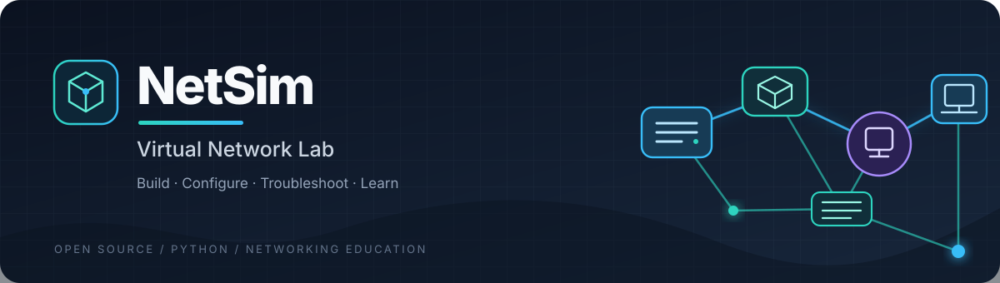
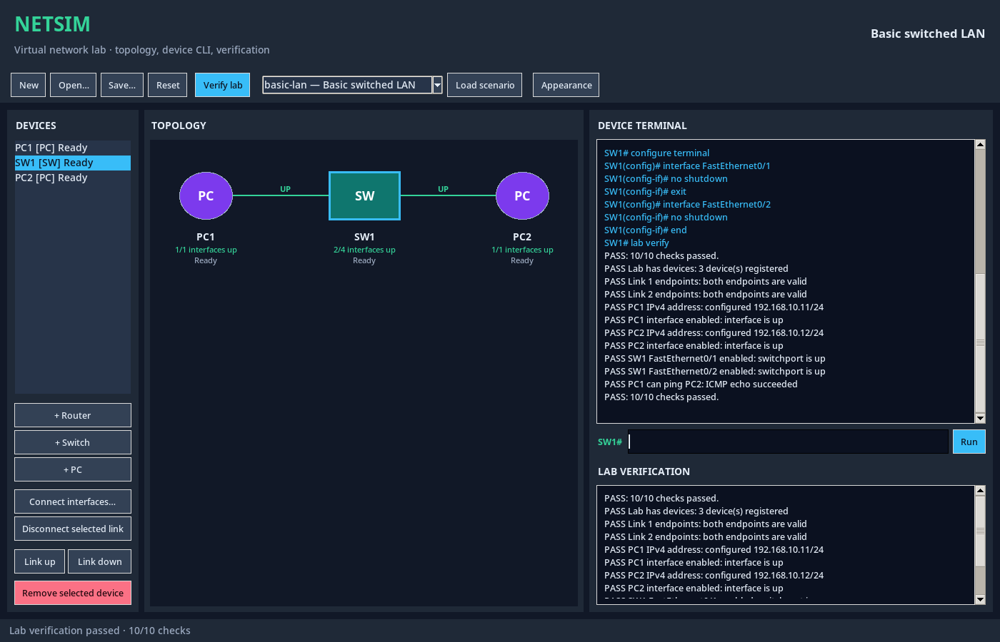
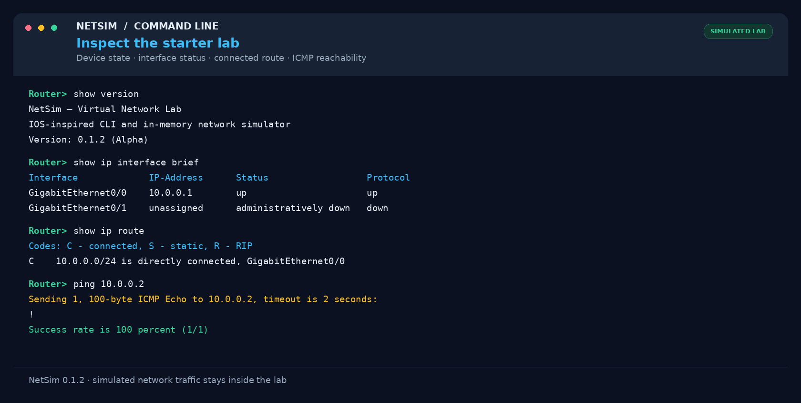
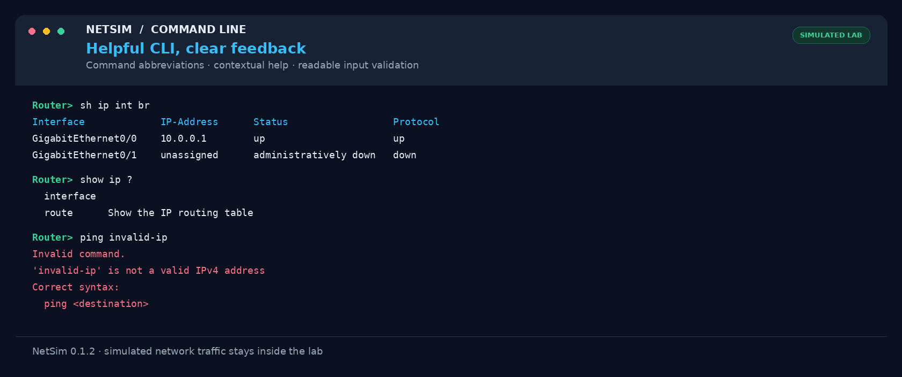
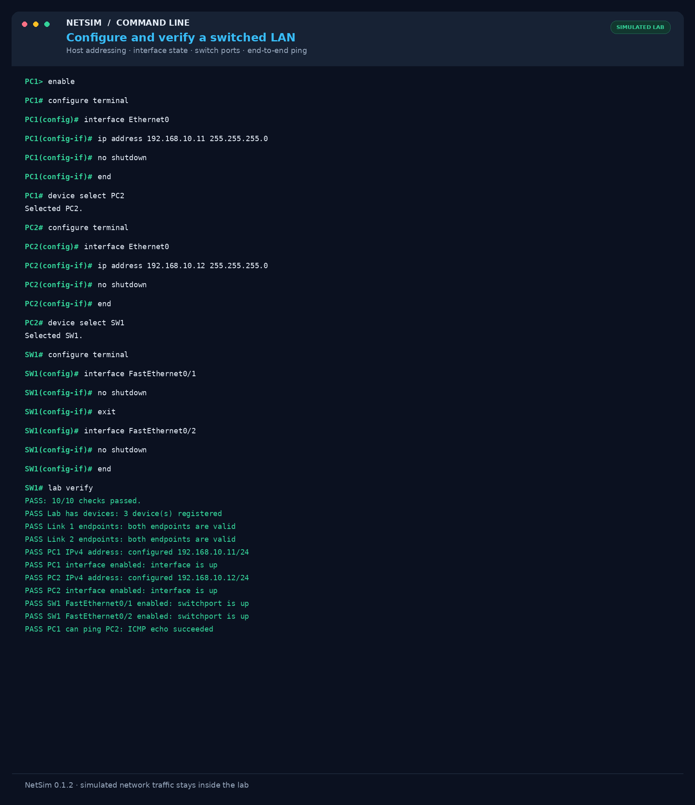
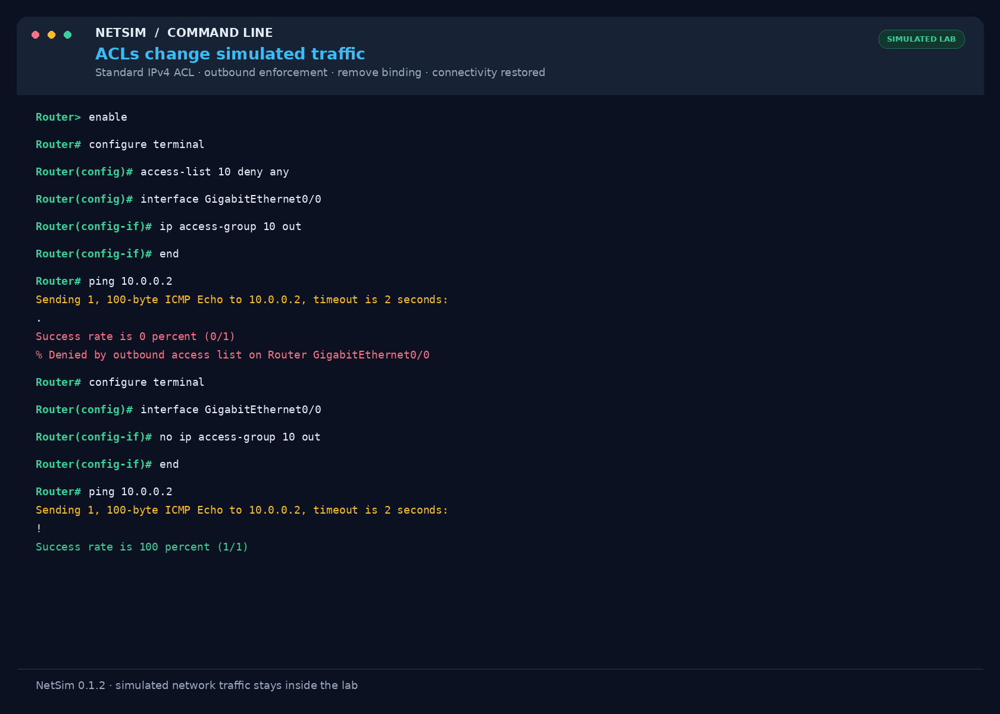
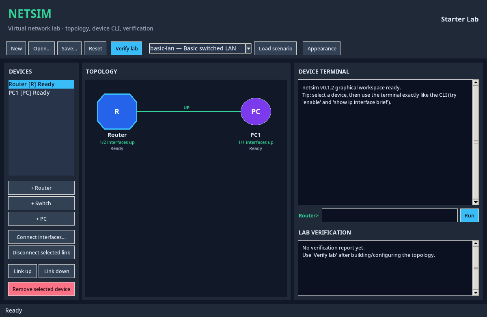

<div align="center">
  
</div>

<div align="center">
  <a href="LICENSE"></a>
  
  
</div>

# NetSim — Virtual Network Lab

**Build a network. Configure it like real equipment. Understand what happens to the traffic.**

NetSim is an open-source network-learning environment built in Python. Create virtual routers, switches, and hosts; connect interfaces; configure an IOS-inspired command-line interface; and investigate switching, VLAN, routing, and access-control behavior without physical lab equipment.

NetSim uses an original command parser and an in-memory simulation engine inspired by public networking concepts and standards. It is an independent educational project and is **not affiliated with or endorsed by Cisco**.

**Quick links:** [Visual tour](docs/visual-tour.md) · [Install and run NetSim](INSTALLATION.md) · [First LAN lab](docs/lab-management.md) · [GUI guide](docs/graphical-workspace.md) · [Troubleshooting](docs/troubleshooting.md) · [Public release checklist](RELEASE_CHECKLIST.md)

> **Project status:** Alpha. The core CLI, device models, Layer 2 switching, ARP/ICMP simulation, connected and static routing, deterministic RIP, standard IPv4 ACLs, portable labs, built-in scenarios, and an optional Tkinter GUI are implemented. Review [current scope and limitations](#scope-and-limitations) before relying on any feature.

## At a glance

- **One backend, two interfaces.** The terminal CLI and GUI use the same device models, workspace, command handlers, and network engine.
- **Inspectable behavior.** Network operations happen inside a deterministic, in-memory topology; the project does not send real packets onto a network.
- **Real configuration state.** Device configuration, interface state, VLAN settings, routes, and standard ACL bindings are modeled as data rather than printed as pretend output.
- **Portable labs.** Save, share, load, reset, and verify JSON lab files.
- **Test-first development.** Unit, integration, acceptance, security-regression, and GUI workflow tests are included.

## See it in action

The screenshots below show the real NetSim 0.1.2 GUI and command results from the in-memory simulator. The GUI example is a configured three-device LAN with all ten verification checks passing; the CLI examples highlight reachability, command help, ACL behavior, and lab verification.

<p align="center">
  
</p>
<p align="center"><em>Graphical workspace — a configured switched LAN, visible topology, embedded CLI, and successful verification report.</em></p>

<table>
  <tr>
    <td width="50%"></td>
    <td width="50%"></td>
  </tr>
  <tr>
    <td><strong>Inspect and connect.</strong> Check interfaces and routes, then verify that the simulated host responds to ICMP.</td>
    <td><strong>Learn by doing.</strong> Use abbreviated commands and contextual help; malformed input produces a useful error rather than a traceback.</td>
  </tr>
  <tr>
    <td width="50%"></td>
    <td width="50%"></td>
  </tr>
  <tr>
    <td><strong>Verify a full lab.</strong> The built-in acceptance checks confirm device addressing, link state, switch ports, and end-to-end ping.</td>
    <td><strong>Understand ACL effects.</strong> See traffic get denied by an ACL, remove the interface binding, and confirm that ping succeeds again.</td>
  </tr>
</table>

For larger images and more context, see the [visual tour](docs/visual-tour.md). CLI visuals are presentation-framed transcripts of commands executed through NetSim's actual runtime; they do not represent live network traffic. All packets remain inside the simulator.

## Features

| Area | Implemented capabilities |
|---|---|
| CLI | Hierarchical configuration modes, command validation, abbreviations, contextual help, history, and completion |
| Devices | Router, switch, and host models; interfaces; IPv4 configuration; administrative state; running/startup configuration |
| Layer 2 | MAC learning and forwarding, access VLANs, trunk allowed-VLAN configuration, and link-state handling |
| Network services | ARP, ICMP echo request/reply simulation, connected/static/default routing, and deterministic RIP convergence |
| Access control | Numbered standard IPv4 ACLs (1–99), source-address rules, inbound/outbound interface bindings, and implicit deny behavior |
| Labs | Device and link management, versioned JSON persistence, built-in scenarios, reset, and verification reports |
| GUI | Device inventory, topology canvas, interface connections, link controls, embedded CLI, scenario verification, and appearance settings |
| Robustness | Bounded lab/config reads, structured input validation, safe YAML loading, and regression tests for malformed input |

## Quick start

### Requirements

- Python **3.10 or newer**
- PyYAML, installed automatically as a runtime dependency
- **GUI only:** Tkinter support in the same Python installation and a graphical desktop

> **Important GUI setup note:** Tkinter is not installed by `pip`. On Ubuntu/Debian, install it with `sudo apt update && sudo apt install python3-tk`. Other operating systems have different setup steps. See the [full installation guide](INSTALLATION.md) and [troubleshooting guide](docs/troubleshooting.md).

### Install from a checkout

Open a terminal in the repository directory (or in the directory where you extracted the project archive), then create a virtual environment:

```bash
python -m venv .venv
```

Activate the virtual environment, then install the project and development tools:

**Linux / macOS**

```bash
source .venv/bin/activate
python -m pip install -e ".[dev]"
```

**Windows PowerShell**

```powershell
.\.venv\Scripts\Activate.ps1
python -m pip install -e ".[dev]"
```

### Launch the terminal

```bash
netsim
```

Or launch it from the source tree:

```bash
python -m netsim
```

The default lab contains a router and a directly connected host so you can start by inspecting device state and trying basic connectivity commands.

### Launch the graphical workspace

```bash
netsim-gui
```

Or:

```bash
python -m netsim.gui
```

A graphical display and a Python installation with Tkinter are required. If `netsim-gui` reports missing Tkinter, follow the OS-specific instructions in [Installation and First Run](INSTALLATION.md#4-optional-gui-dependency-tkinter). If a display is unavailable, the terminal interface remains usable. See [Troubleshooting](docs/troubleshooting.md) for common startup and dependency errors.

### Preview



## First lab

At the simulator prompt, inspect the devices and topology, then load a built-in scenario:

```text
Router> show devices
Router> lab list-scenarios
Router> lab scenario basic-lan
Router> show topology
Router> lab verify
```

The `basic-lan` scenario demonstrates a switched local network. The `vlan-isolation` scenario demonstrates how access VLAN boundaries prevent direct Layer 2 connectivity when no Layer 3 routing is configured between the VLANs.

Common lab-management commands include:

```text
Router> device add router R2 GigabitEthernet0/0,GigabitEthernet0/1
Router> connect R1 GigabitEthernet0/1 R2 GigabitEthernet0/0
Router> link down R1 GigabitEthernet0/1
Router> link up R1 GigabitEthernet0/1
Router> disconnect R1 GigabitEthernet0/1
Router> lab save practice-lab.json
Router> lab load practice-lab.json
Router> lab reset
```

For full command examples and persistence rules, see the [Lab Management Guide](docs/lab-management.md).

## Standard IPv4 ACL example

NetSim supports numbered standard ACLs that match the source IPv4 address. Rules are evaluated in order, the first matching rule wins, and the implicit deny applies to unmatched traffic once the ACL has at least one rule.

```text
Router> enable
Router# configure terminal
Router(config)# access-list 10 deny 10.0.0.0 255.255.255.0
Router(config)# access-list 10 permit any
Router(config)# interface GigabitEthernet0/1
Router(config-if)# ip access-group 10 out
```

Remove an interface binding without removing the ACL rules:

```text
Router(config-if)# no ip access-group 10 out
```

A simulated ping is successful only if the echo request can reach the destination and the echo reply can return. Routing, link state, ARP, and applicable ACL rules are considered along the path.

## How it is structured

```text
src/netsim/
├── core/       Configuration, events, exceptions, logging
├── cli/        Parser, modes, command registry, terminal interface
├── devices/    Router, Switch, Host, interfaces, ACLs, configuration
├── network/    Topology, links, Ethernet, ARP, IPv4, ICMP, routing, RIP
├── labs/       Workspace lifecycle, JSON persistence, scenarios, verification
└── gui/        Optional Tkinter application sharing the same backend

tests/          Unit, integration, acceptance, regression, and GUI tests
docs/           Architecture, usage, security notes, and feature guides
assets/         Project branding assets
```

The CLI and GUI are front ends. Devices own their configuration; `NetworkEngine` owns simulated packet-path behavior and dynamic protocol state; `LabWorkspace` orchestrates topology and persistence. See the [Architecture Overview](docs/architecture.md) for the main boundaries and state model.

## Configuration and saved data

User settings are stored in a per-user configuration directory. The resolution order is:

1. `NETSIM_CONFIG_DIR`, when set
2. `$XDG_CONFIG_HOME/netsim` on systems that use the XDG convention
3. `~/.netsim` as a cross-platform fallback

Lab files are versioned JSON documents. A lab import is validated before the active workspace is replaced. Learned ARP entries, switch MAC tables, and RIP-learned routes are runtime state and are deliberately recreated rather than persisted.

## Installation, support, and troubleshooting

- [Installation and First Run](INSTALLATION.md): source archive setup, virtual environments, platform-specific Tkinter setup, CLI/GUI launch, and verification.
- [Troubleshooting](docs/troubleshooting.md): missing Tkinter, headless display, missing commands/dependencies, test skips, and lab verification failures.
- [Lab Management Guide](docs/lab-management.md): device and link operations, first working LAN, save/load/reset, and runtime-state behavior.
- [Graphical Workspace Guide](docs/graphical-workspace.md): GUI workflows, requirements, tests, and current GUI limits.
- [Architecture Overview](docs/architecture.md): component boundaries and state ownership.
- [Security and Robustness](docs/security-and-robustness.md) and [Security Policy](SECURITY.md): security scope and reporting guidance.

## Development and tests

Install development dependencies from the repository root:

```bash
python -m pip install -e ".[dev]"
```

Run the complete test suite, promoting resource warnings to failures:

```bash
python -m pytest -q -W error::ResourceWarning
```

GUI construction and workflow tests skip when no display is available. On Linux with Xvfb installed, run them as well:

```bash
xvfb-run -a python -m pytest -q -W error::ResourceWarning
```

The automated CI workflow runs the test suite across supported Python versions and operating systems. Passing tests improve confidence but do not guarantee that the simulator is defect-free.

Contribution expectations are documented in [CONTRIBUTING.md](CONTRIBUTING.md). Security-related reports should follow [SECURITY.md](SECURITY.md).

## Scope and limitations

NetSim is a learning simulator, not a full implementation of a vendor operating system or a live penetration-testing tool. Its current behavior is deliberately bounded:

- It does not emit or inspect live network traffic and does not scan external hosts.
- Standard IPv4 ACLs are implemented; extended ACLs and protocol/port matching are not.
- RIP uses explicit deterministic convergence rather than wall-clock protocol timers. Triggered updates, route poisoning, and holddown are not modeled.
- OSPF, STP/RSTP, EtherChannel, NAT/PAT, DHCP, TCP/UDP applications, packet animation, and drag-and-drop topology placement are not currently implemented.
- The GUI uses an automatic deterministic layout and is intended to make the existing simulator easier to explore, not to replace a full network-design suite.
- Security checks cover selected local input and file-handling risks; they are not a formal certification or a substitute for a broader security review.

## Roadmap

The initial nine implementation stages are complete: project foundation, CLI engine, device models, network engine, Layer 2/VLANs, RIP, standard ACLs, lab management, and GUI/release polish. Future work should prioritize carefully scoped features with tests that preserve existing routing, switching, lab, and CLI behavior.

## License

NetSim is distributed under the MIT License. See [LICENSE](LICENSE).
